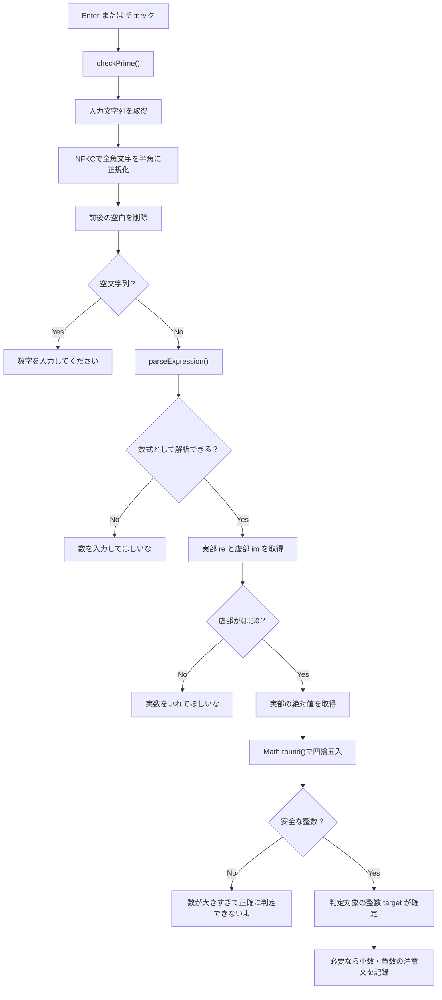
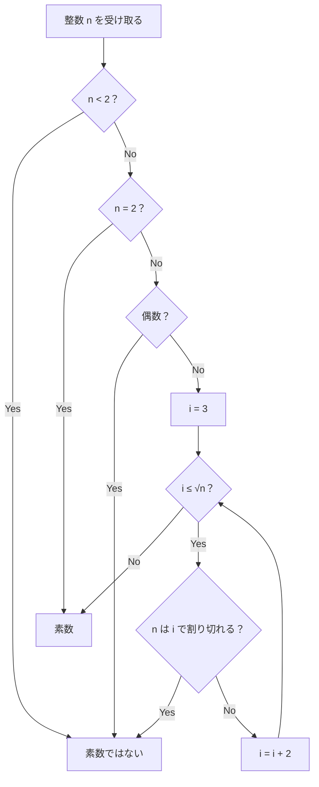
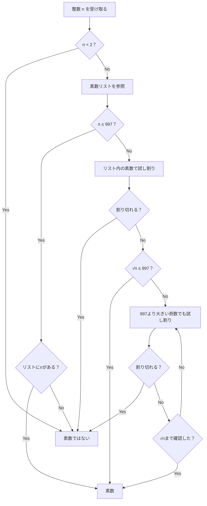
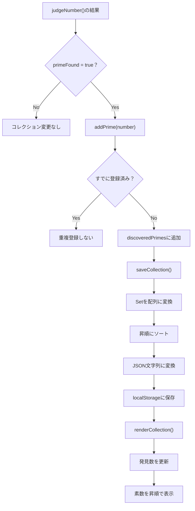
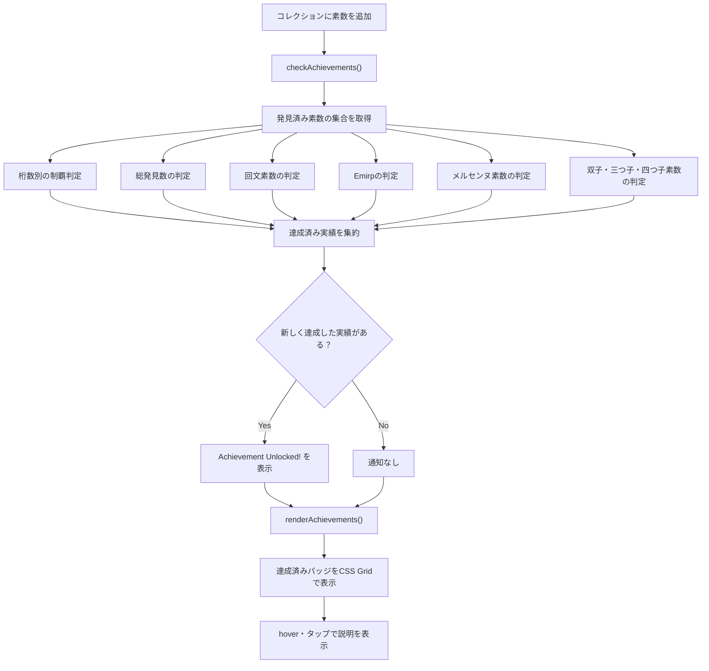
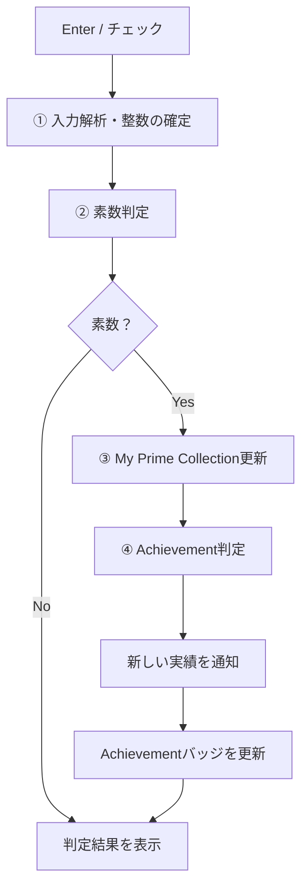

# 素数判定Webアプリ：処理フローとv2改修候補

Enterキーまたは「チェック」ボタンで `checkPrime()` が呼ばれ、入力文字列の解析が始まる。以下は添付された既存の `script.js` を基準とし、Achievement拡張部分は実装計画を含む。

## ① 入力文字列から整数を得るまで

**担当：** `checkPrime()` → `judgeNumber()` → `parseExpression()`

現行コードは入力が整数でなくても終了せず、素数判定用の整数を確定する。

| 入力 | 解析結果 | 判定対象 |
|---|---|---|
| `7` | 7 | 7 |
| `７` | 7 | 7 |
| `6.8` | 6.8 | 7 |
| `-7` | -7 | 7 |
| `3+4` | 7 | 7 |
| `2i` | 0+2i | 判定しない |

`6.8` や `-7` は注意文を表示したうえで補正後の7を判定する。

## ② 整数が素数かどうかを判定するまで

**担当：** `isPrime()`

### 現行の判定フロー

2を特別扱いした後、3以上の奇数で試し割りをする。

### 改善案：素数リストを利用

発見済み素数だけでは、未発見の約数を見落とす可能性がある。判定にはアプリが生成した正しい素数リストを使う。上図は概念図であり、実装ではループ条件を適切に管理する。

## ③ 素数をMy Prime Collectionに表示するまで

**担当：** `addPrime()`、`saveCollection()`、`renderCollection()`

`Set` は重複登録を防ぎ、`localStorage` は同じオリジン・ブラウザ内で再読み込み後も記録を維持する。17 → 3 → 11 → 2の順に発見しても、表示は `2 3 11 17` となる。

## ④ 素数がAchievementに関連するか確認するまで

**担当：** `checkAchievements()`、`renderAchievements()`（拡張予定）

Achievementはコレクションから再計算する。例えば `new Set([2,3,5,7,11,13,17,19,23,29])` なら、1桁制覇、10個発見、双子素数4組、メルセンヌ素数2個を判定できる。回文素数10個とEmirp10個は未達成。1つの素数が複数実績に貢献できる。リセットすれば実績も初期化される。

## ⑤ 4つの処理の関係

実際には `checkPrime()` が表示と追加処理を呼び出す。BigInt対応時は①②だけでなく③④の保存形式・数値操作にも対応が必要。

## v2実装候補

- NumberとBigIntの自動切り替え（精度喪失前に切り替える）
- 巨大整数を正確に扱う数式解析
- Miller–Rabin法などによる高速素数判定
- 素数発見時の「nは」「素数」「だぁぁぁぁぁあ！」の3段階アニメーション
- スマホ向けの短縮表示「nは」「素数」「だ！！」

**今回の方針：** ①②の既存処理をなるべく維持し、③④を中心に改訂する。
